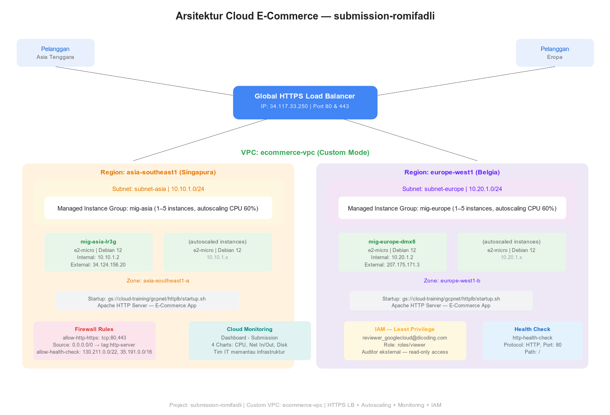
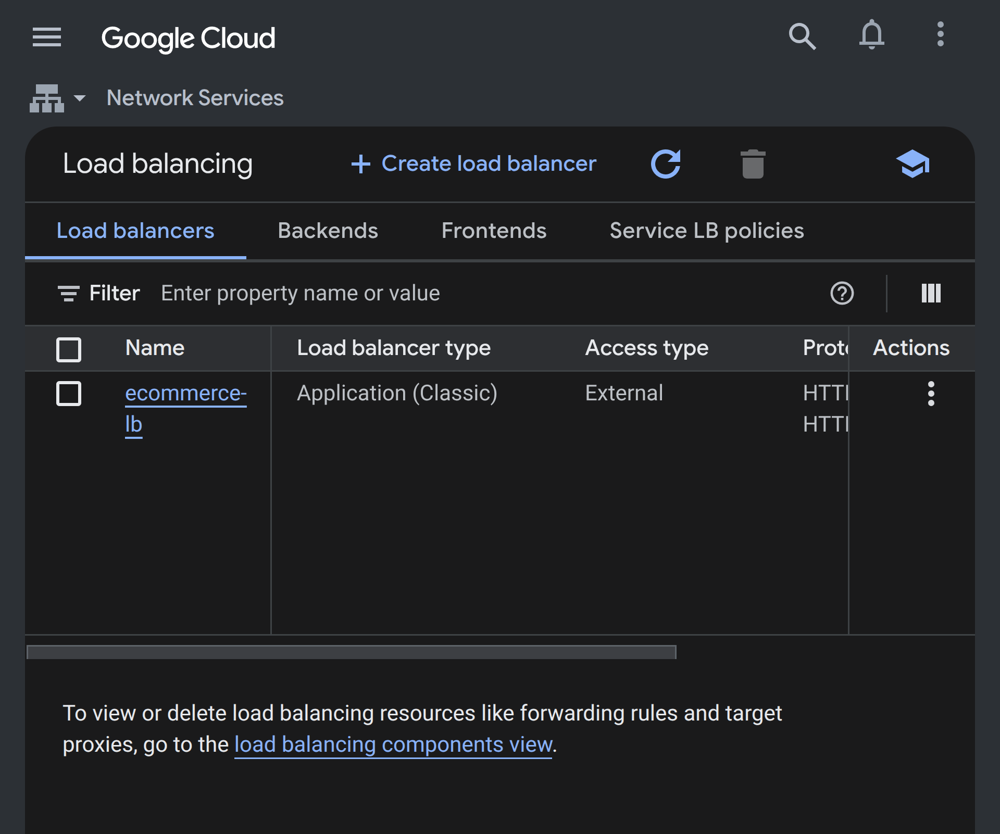
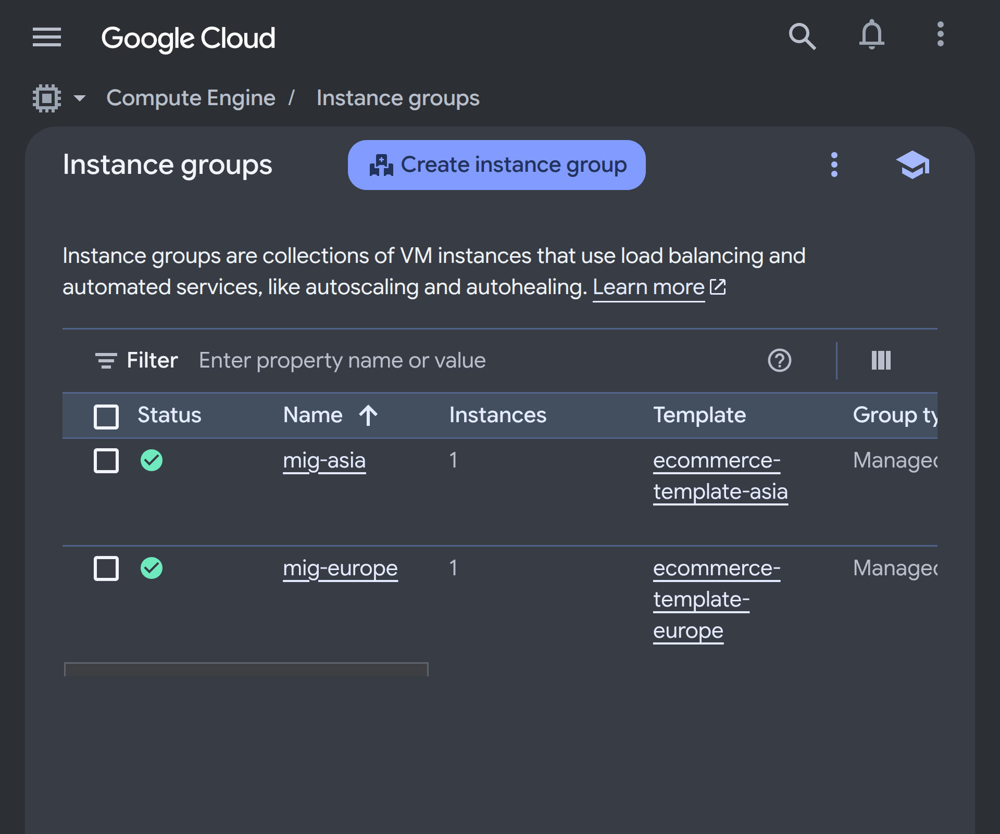
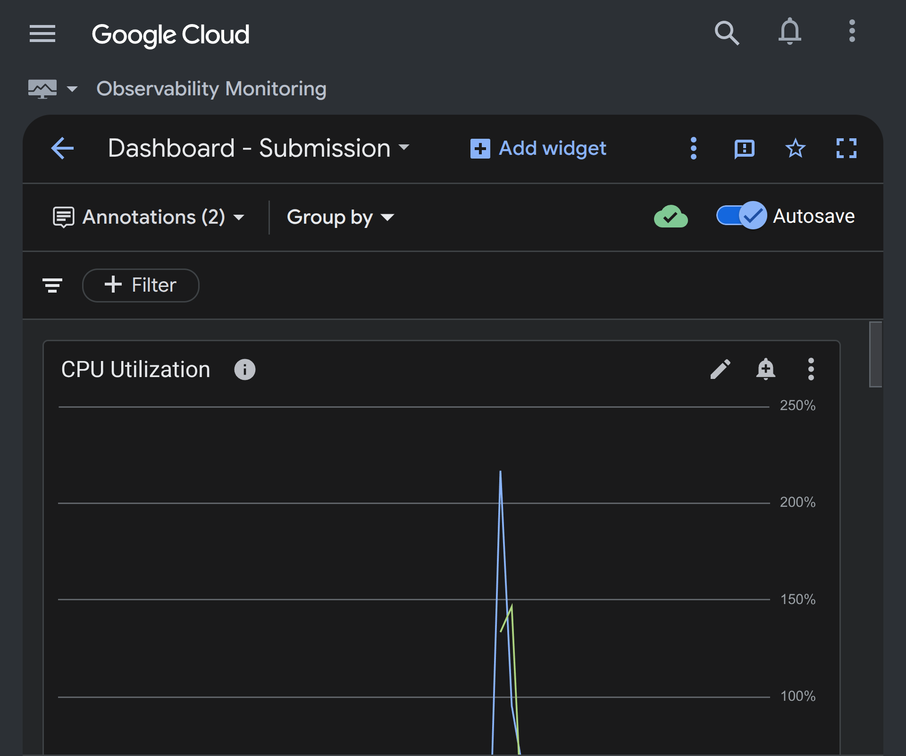
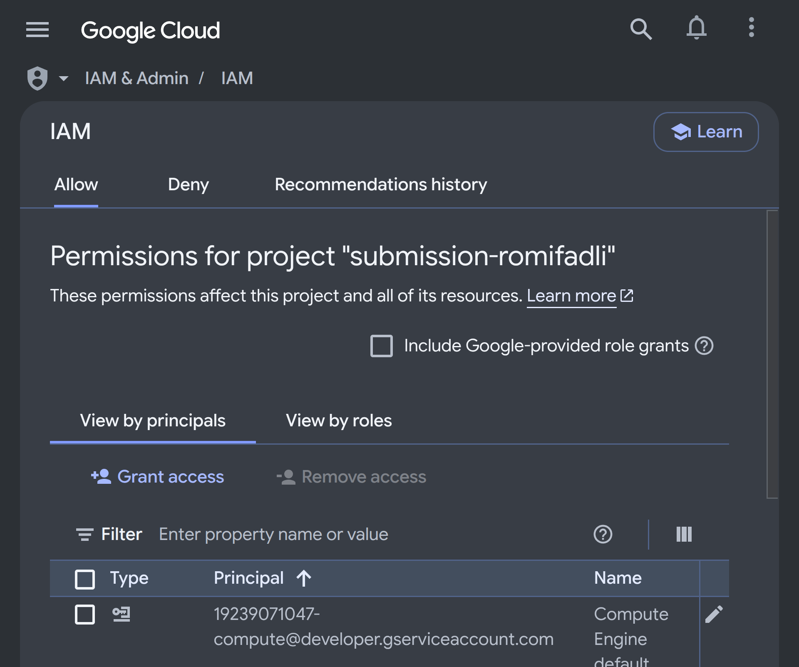
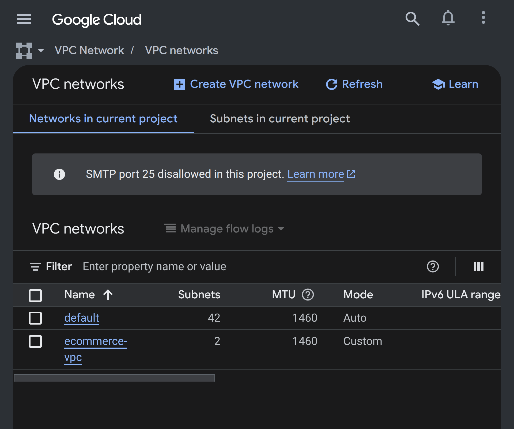

# GCP Multi-Region E-Commerce Architecture

A production-grade Google Cloud Platform architecture for a highly available e-commerce application, featuring multi-region deployment across Asia and Europe with global HTTPS load balancing, auto-scaling, and Cloud Monitoring.



## Architecture Overview

```
                    Internet
                       │
              ┌────────┴────────┐
              │  Global HTTPS   │
              │  Load Balancer  │
              │  (34.117.33.250)│
              └───────┬─┬───────┘
                      │ │
        ┌─────────────┘ └─────────────┐
        ▼                             ▼
┌───────────────┐            ┌───────────────┐
│ MIG Asia      │            │ MIG Europe    │
│ asia-southeast1│           │ europe-west1  │
│ 1-5 instances │            │ 1-5 instances │
│ (e2-micro)    │            │ (e2-micro)    │
└───────────────┘            └───────────────┘
```

## Components

### Networking
- **Custom VPC** (`ecommerce-vpc`) with two subnets:
  - `subnet-asia` — `asia-southeast1` — `10.10.1.0/24`
  - `subnet-europe` — `europe-west1` — `10.20.1.0/24`
- **Firewall rules** for HTTP/HTTPS traffic and health check probes

### Compute
- **Instance Templates** per region (e2-micro, Debian 12, startup script)
- **Managed Instance Groups** with autoscaling (min 1, max 5, target CPU 60%)

### Load Balancing
- **Global external HTTPS Load Balancer** with static IP
- HTTP-to-HTTPS forwarding
- Backend service with health checks

### Monitoring
- **Cloud Monitoring Dashboard** with:
  - CPU utilization (line chart)
  - Network bytes received (scorecard)
  - Disk read operations (stacked bar)
  - Network bytes sent (stacked area)

### IAM
- Least-privilege access: reviewer group assigned `roles/viewer` only

## Screenshots

| Resource | Screenshot |
|----------|-----------|
| Load Balancer |  |
| Instance Groups |  |
| Monitoring Dashboard |  |
| IAM Configuration |  |
| VPC Networks |  |

## Cost Estimate

| Resource | Estimated Cost/Month |
|----------|---------------------|
| 2× e2-micro instances | ~$15.97 |
| Global LB (2 forwarding rules) | ~$18.27 |
| Standard PD 10GB × 2 | ~$0.80 |
| **Total** | **~$35/month** |

## Files

- `arsitektur-diagram.svg` / `.png` — architecture diagram
- `gcp-resources.md` — detailed resource inventory
- `initial-design.md` — initial architecture design (first iteration)
- `config.txt` — GCP Pricing Calculator link
- `screenshots/` — GCP Console screenshots

## Tech Stack

- Google Compute Engine (Managed Instance Groups, Autoscaling)
- Global External HTTPS Load Balancer
- Custom VPC with multi-region subnets
- Cloud Monitoring
- IAM (least-privilege)

## License

MIT
